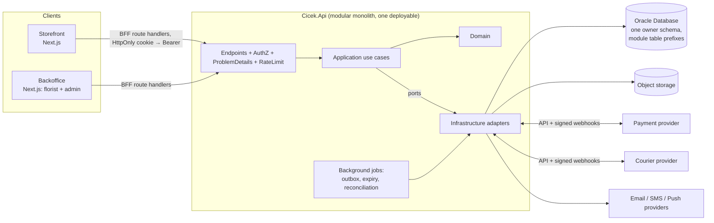
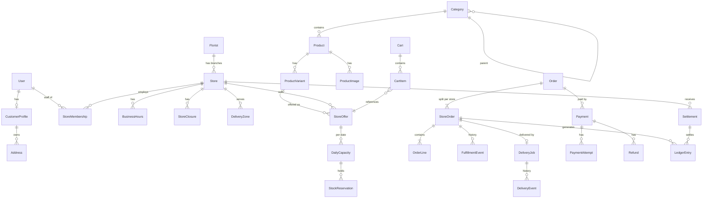
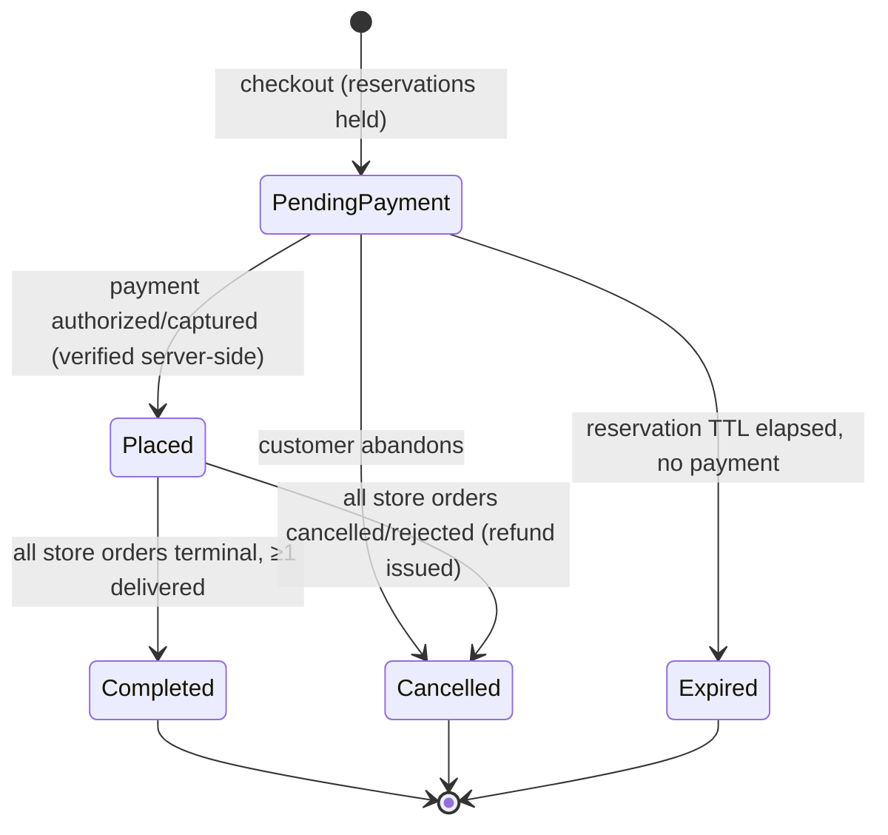
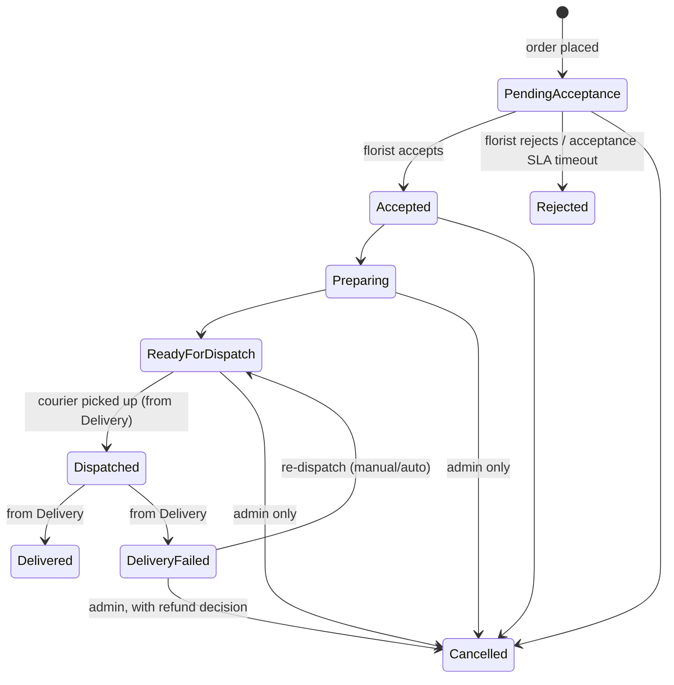
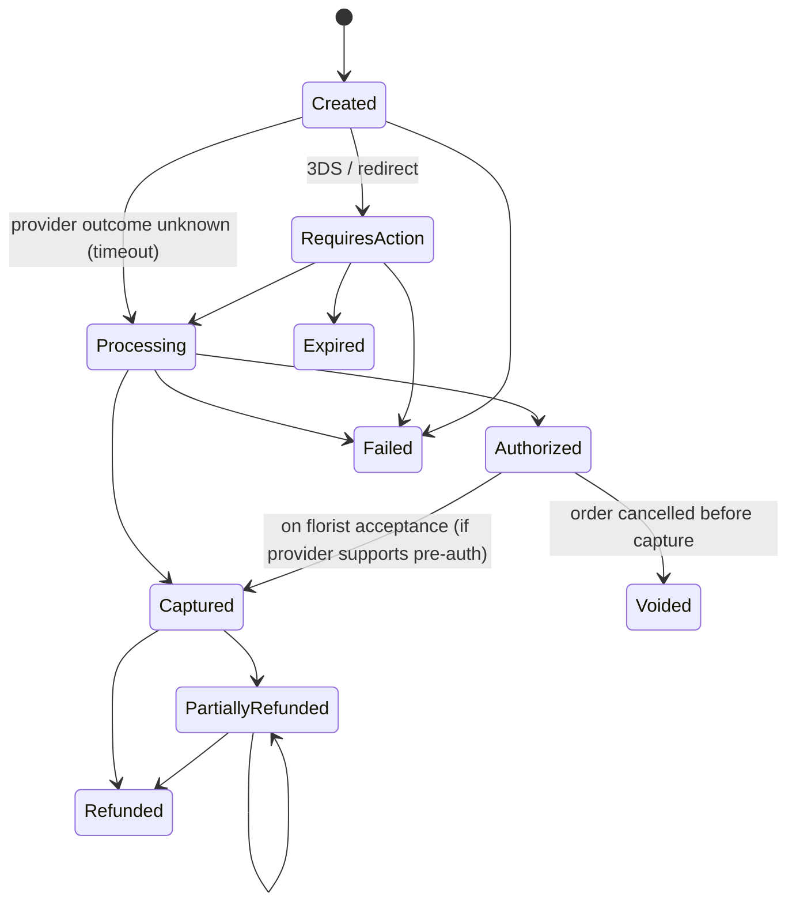
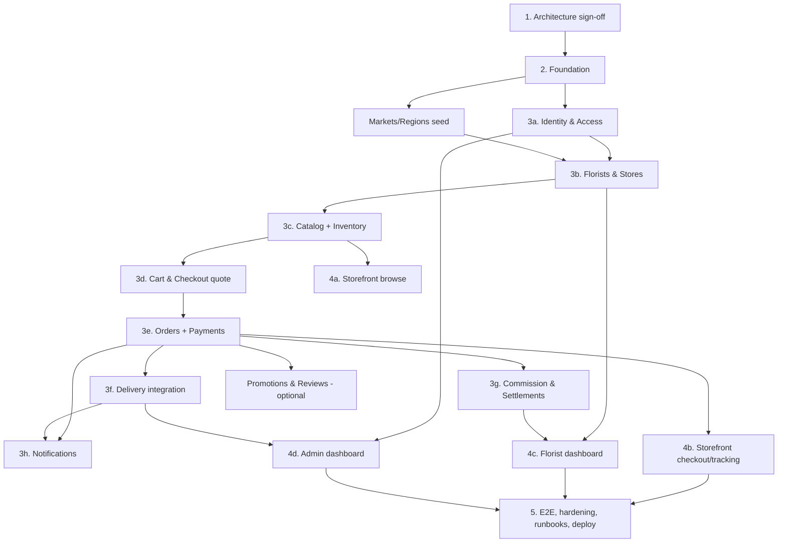

# Flower Delivery Marketplace — Architecture & Implementation Plan

| Stage | Status | Date |
|---|---|---|
| 1. Architecture | Presented 2026-10-02. No explicit sign-off was recorded; Stage 2 proceeded on the stakeholder's instruction. The essential business questions in §7 are still open. | 2026-10-02 |
| 2. Foundation | **Implemented and verified** (see "Current implementation" below). The database changed from PostgreSQL to **Oracle Database** (ADR-0009). | 2026-10-13 |
| 3. Core marketplace | **Implemented and verified**: shops, catalogue, cart, checkout, orders, commission ([marketplace-core.md](marketplace-core.md), ADR-0012). No payment/courier integration. | 2026-10-13 |

## Current implementation (Stages 2–3)

Everything below this section is the target architecture; only the items listed here exist in code.

| Area | Implemented | Where |
|---|---|---|
| Solution | SharedKernel, Domain, Application, Infrastructure, Api, DbMigrator + 5 test projects | `backend/` |
| Persistence | Oracle via `Oracle.EntityFrameworkCore` 10.23.26301 / ODP.NET Core 23.26.301; migrations `InitialIdentity`, `Marketplace`, `NullableOptionalText` | `Infrastructure/Persistence` |
| Database security | Schema owner `CICEK_OWNER` (DDL, migrations) vs runtime `CICEK_APP` (DML via `CICEK_APP_ROLE`, no DDL) | `db/bootstrap`, ADR-0009 |
| PL/SQL | `cicek_schema_access` (v2) — syncs runtime-role privileges after migrations; audit and order-history tables append-only (the only DB-side component) | `Persistence/Sql/Packages`, ADR-0010 |
| Identity | Customer registration, login (lockout), JWT access tokens, rotating refresh tokens with reuse detection, logout, `/me` | `Application/Auth`, `Api/Auth` |
| Authorization | Code-defined roles → permissions (`system.status.read`, `shops.manage`, `categories.manage`, `orders.read`, `orders.manage`); shop-scoped rights from shop membership (Owner/Staff) |
| Marketplace | Shops (apply/approve/suspend, open/close), categories, products (search/filter/sort/paging, images by URL), cart (server pricing, multi-shop), checkout (idempotent, atomic stock reservation, one order per shop), order state machine, commission snapshot, manual payment recording, unpaid-order expiry, audit log | `Domain`, `Application`, `Api/Endpoints` | `Application/Authorization` |
| API infrastructure | `/api/v1`, OpenAPI (build-time document), Problem Details, Oracle error translation, validation, correlation ids, rate limiting, CORS (closed), security headers, `/health/live` + `/health/ready` | `Api/` |
| Frontend | npm workspace: `apps/storefront` (Next.js 16, BFF, HttpOnly session cookies; auth, catalogue, shops, cart, checkout, order history, seller area), `packages/ui`, `packages/api-client` (generated from OpenAPI) | `frontend/` |
| Local dev & CI | Docker Compose (Oracle Database Free + migrator + API + storefront), GitHub Actions workflow | `deploy/`, `.github/` |

**Not yet implemented:** payment provider, refunds execution, courier integration, settlements/payouts, notifications, outbox/inbox, delivery zones and time slots, product variants, image upload, promotions, reviews, email/phone verification, password reset, staff invitations, admin UI (`apps/backoffice`), guest checkout.

**Stage 1 model mapping:** Stage 1 "Order" (customer level) is implemented as `Checkout`; Stage 1 "StoreOrder" (per florist) is implemented as `Order`. Fulfilment and payment states are combined in the per-shop order status for now (no provider yet); they will be separated when payment and delivery lifecycles exist (§4).

### Responsibility split: C# vs PL/SQL

| Concern | Lives in | Why |
|---|---|---|
| Business rules, workflows, state machines, validation | C# Domain / Application | Testable without a database; one place for each rule |
| Data access, transactions, optimistic concurrency | C# Infrastructure (EF Core) | Caller-owned transactions; provider-neutral ports |
| Constraints (PK/FK/unique/check) | Oracle schema (from EF migrations) | Integrity under any access path |
| Runtime privilege management | PL/SQL `cicek_schema_access` | Must be derived from the owner's data dictionary and issued as DDL by the owner (ADR-0010) |
| Future candidates (only with a documented reason) | PL/SQL | E.g. a multi-row atomic inventory reservation, reporting aggregates |

## 0. Repository inspection (Stage 1, 2026-10-02)

| Item | Finding |
|---|---|
| Existing code | None — the workspace was empty. No conventions to inherit. |
| Version control | Not a git repository; **git is not installed** on this machine. |
| .NET SDKs | 10.0.300 (LTS — target), 9.0.301 |
| Node / npm | 22.11.0 (LTS) / 10.9.0 |
| Docker | 29.2.0, Compose v5.0.2 |
| Database (Stage 2 audit) | Oracle Database 21c XE installed natively (service + listener running, PDB `XEPDB1`, AL32UTF8) |

Consequences: greenfield. Target **.NET 10 LTS**, **EF Core 10**, **Node 22 LTS**, **Next.js (App Router)**. *Database: originally PostgreSQL 17; superseded in Stage 2 by **Oracle Database** (19c+ compatible SQL; local XE 21c / Docker Database Free) — ADR-0009.*

---

## 1. Solution & folder structure

```
cicek/
├─ backend/
│  ├─ Cicek.slnx
│  ├─ global.json                  # pins SDK 10.0.x
│  ├─ Directory.Build.props        # nullable, warnings-as-errors, analyzers, LangVersion
│  ├─ Directory.Packages.props     # central package version management
│  ├─ .editorconfig
│  ├─ src/
│  │  ├─ Cicek.SharedKernel/       # Money, Currency, Entity/AggregateRoot, DomainEvent, Result/Error, IClock
│  │  ├─ Cicek.Domain/             # pure C#: no EF, no ASP.NET references
│  │  │   ├─ Identity/  Customers/  Stores/  Catalog/  Inventory/
│  │  │   ├─ Ordering/  Payments/   Delivery/  Settlements/
│  │  │   ├─ Notifications/  Reviews/  Promotions/  Markets/
│  │  ├─ Cicek.Application/        # use cases per module
│  │  │   ├─ Abstractions/         # ports: IPaymentGateway, ICourierGateway, IEmailSender,
│  │  │   │                        #   ISmsSender, IPushSender, IFileStorage, ICurrentUser, IAppDbContext…
│  │  │   └─ <Module>/{Commands,Queries,Dtos,Validators,EventHandlers}
│  │  ├─ Cicek.Infrastructure/
│  │  │   ├─ Persistence/          # AppDbContext, Configurations/<Module>, Migrations,
│  │  │   │                        #   Outbox, Inbox, Idempotency, Interceptors (audit, timestamps)
│  │  │   ├─ Identity/             # ASP.NET Core Identity stores, token service
│  │  │   ├─ Payments/<Provider>/  + Payments/Fake/   (DEV-ONLY, clearly labelled)
│  │  │   ├─ Delivery/<Provider>/  + Delivery/Fake/   (DEV-ONLY, clearly labelled)
│  │  │   ├─ Notifications/        # SMTP/email, SMS, push adapters; template rendering
│  │  │   ├─ Storage/              # S3-compatible object storage
│  │  │   └─ BackgroundJobs/       # outbox dispatcher, reservation expiry, reconciliation
│  │  └─ Cicek.Api/
│  │      ├─ Endpoints/<Audience>/<Module>/   # Minimal API endpoint groups, thin
│  │      ├─ Auth/                 # policies, permission handlers, store-scope handler
│  │      ├─ Middleware/           # correlation ID, problem details, idempotency
│  │      ├─ OpenApi/  RateLimiting/  HealthChecks/
│  │      └─ Program.cs
│  └─ tests/
│     ├─ Cicek.Domain.Tests/          # xUnit: invariants, state machines, money
│     ├─ Cicek.Application.Tests/     # use cases with in-memory fakes of the ports
│     ├─ Cicek.Infrastructure.Tests/  # persistence, concurrency, adapters with recorded responses
│     ├─ Cicek.Api.Tests/             # WebApplicationFactory: authz matrix, webhooks, idempotency
│     └─ Cicek.ArchitectureTests/     # layer & module dependency rules
├─ frontend/
│  ├─ package.json                 # npm workspaces
│  ├─ apps/
│  │  ├─ storefront/               # public, SEO-oriented customer site (Next.js)
│  │  └─ backoffice/               # authenticated florist + admin dashboards (Next.js)
│  ├─ packages/
│  │  ├─ ui/                       # accessible Tailwind component library
│  │  ├─ api-client/               # types generated from OpenAPI + typed fetch client + error mapping
│  │  └─ config/                   # shared tsconfig, eslint, prettier, tailwind preset
│  └─ e2e/                         # Playwright
├─ deploy/
│  ├─ docker-compose.yml           # oracle (Database Free), migrator, api, storefront
│  ├─ .env.example                 # no real secrets ever committed
│  └─ docker/                      # Dockerfiles
├─ docs/
│  ├─ ARCHITECTURE.md              # this file
│  ├─ adr/                         # architecture decision records
│  └─ runbooks/                    # backup/restore, payment recovery, delivery recovery, deploy/rollback
├─ .github/workflows/ci.yml        # assumes GitHub Actions (see questions)
└─ README.md
```

**Why one project per layer, not per module?** At this size, per-module projects (×4 layers × 13 modules) cost more in build friction than they buy. Module boundaries are enforced by namespaces plus architecture tests instead. Any module can be extracted into its own projects later without changing behaviour (ADR-0001).

---

## 2. System architecture & module boundaries



Dependency rule: `Api → Application → Domain → SharedKernel`; `Infrastructure → Application`. Domain references nothing framework-specific.

### Module map

| Module | Owns | Depends on (by ID / application interface only) |
|---|---|---|
| Markets | Country/currency/locale/timezone/tax mode, delivery regions (city → district) | — |
| Identity | Users, roles, permissions, sessions, verification, audit log | — |
| Customers | Profiles, addresses | Identity, Markets |
| Stores | Florists, branches, approval, hours, closures, delivery zones, staff memberships | Identity, Markets |
| Catalog | Categories, products, variants, images, store offers (store-specific price) | Stores |
| Inventory | Daily capacity per offer, reservations | Catalog, Stores |
| Promotions *(optional)* | Coupons, promotional prices, redemptions | Catalog |
| Ordering | Carts, checkout quote, orders, store orders, status history | Catalog, Inventory, Stores, Promotions, Payments (port) |
| Payments | Payments, attempts, refunds, webhook inbox, reconciliation | Ordering (events) |
| Delivery | Delivery jobs, courier events, manual recovery | Ordering (events), Stores |
| Settlements | Commission rules, ledger, settlements | Ordering & Payments (events) |
| Notifications | Templates, outbound messages, dedupe | Subscribes to events |
| Reviews *(optional)* | Product/store reviews, moderation | Ordering (eligibility query) |

Rules (enforced by architecture tests):
- Modules reference other modules' aggregates **by ID only**; no cross-module EF navigation properties.
- Cross-module side effects use **domain events → transactional outbox** (for example, `OrderPaid` creates `StoreOrder` notifications, the delivery job, and ledger entries). Synchronous cross-module reads go through small query interfaces such as `IOfferPricingQuery`.
- One `AppDbContext`, one Oracle schema owner (`CICEK_OWNER`), **module tables distinguished by prefix** (`IDN_`, later `STR_`, `CAT_`, `ORD_` …). In Oracle a schema is a user account, so schema-per-module would multiply accounts and grants without benefit (ADR-0009). One database still allows a real ACID transaction where a single use case needs one (checkout reservation plus order creation).

---

## 3. Main entities & relationships

Conventions (Oracle, ADR-0009): `Guid` primary keys generated in C# (`RAW(16)`); instants as `DateTimeOffset` in UTC (`TIMESTAMP(7) WITH TIME ZONE`); money as `NUMBER(19,4)` plus a `CHAR(3)` ISO-4217 currency, wrapped in a `Money` value object with currency-aware rounding; text as `NVARCHAR2(n)` with explicit lengths; booleans as `NUMBER(1)`; enums persisted as strings with CHECK constraints; optimistic concurrency via an application-maintained `ROW_VERSION NUMBER(19)` column; upper-snake-case identifiers.



| Module | Entity | Key fields / invariants |
|---|---|---|
| Identity | `User` (ASP.NET Core Identity) | email/phone (unique, normalized), verification flags, lockout, `UserType` |
| | `Role`, `Permission`, `RolePermission` | permissions are code-defined constants, seeded |
| | `StoreMembership` | (UserId, StoreId) unique; store-scoped permission set (e.g. `orders.manage`, `catalog.manage`, `finance.view`, `staff.manage`) |
| | `RefreshSession` | hashed token, family id (reuse detection), device info, expiry, revokedAt |
| | `AuditLogEntry` | actor, action, target type/id, before/after (PII-redacted), IP, correlation id; append-only |
| Customers | `CustomerProfile` | name, phone, marketing consent + timestamp |
| | `Address` | recipient name/phone, region (city/district from Markets), line, postal code, optional lat/lng, `IsDefault` (one default per customer, enforced by a function-based unique index created in a migration, because the Oracle provider does not support filtered indexes) |
| Markets | `Market` | country, currency, default locale, timezone, `PricesIncludeTax`, phone format |
| | `Region` | hierarchical (city → district → neighbourhood); delivery zones reference regions |
| | `TaxRate` | market + tax category + effective dates |
| Stores | `Florist` | legal name, tax id, IBAN (encrypted), status `Pending/Approved/Suspended/Closed` |
| | `Store` (branch) | address, geo, status, acceptance SLA minutes, same-day cutoff, max daily orders |
| | `BusinessHours`, `StoreClosure` | weekly hours; date-ranged temporary closures |
| | `DeliveryZone` | store + region, delivery fee, min order amount, available slots |
| Catalog | `Category` | tree, slug (unique per market), sort, active |
| | `Product` | platform-level product: name/description (localized), tax category, gift options, slug, status |
| | `ProductVariant` | size/colour/arrangement attributes, SKU |
| | `ProductImage` | object-storage key, alt text (localized), order |
| | `StoreOffer` | (StoreId, VariantId) unique; price `Money`, compare-at price, active/paused, prep time |
| Inventory | `DailyCapacity` | (OfferId, Date) unique; `Capacity`, `Reserved`, `Sold`; CHECK `Reserved + Sold <= Capacity` |
| | `StockReservation` | offer, date, qty, cart/order id, `ExpiresAt`, status `Active/Committed/Released/Expired` |
| Ordering | `Cart`, `CartItem` | customer or guest token; holds no authoritative prices |
| | `Order` | **OrderNumber** (unique, human-friendly, from DB sequence), customer or guest contact, billing snapshot, totals snapshot, currency, `OrderStatus`, `IdempotencyKey` (unique) |
| | `StoreOrder` | store, recipient snapshot, address snapshot, delivery date + slot, gift message, `FulfillmentStatus`, commission snapshot |
| | `OrderLine` | **snapshots**: product name, variant label, image, unit price, tax rate, discount, commission rate/amount |
| | `FulfillmentEvent` / `OrderNote` | status history with actor and reason; internal vs customer-visible notes |
| Payments | `Payment` | order, amount, currency, provider, provider reference, `PaymentStatus`, captured/refunded amounts |
| | `PaymentAttempt` | per provider call: request idempotency key, outcome, sanitized raw response |
| | `Refund` | amount, reason, `RefundStatus`, provider ref, initiated by |
| | `InboxMessage` | (Provider, ExternalEventId) unique: webhook deduplication + raw payload |
| Delivery | `DeliveryJob` | store order, provider, external id, `DeliveryStatus`, courier info, ETA, failure reason, attempt count |
| | `DeliveryEvent` | provider event, mapped status, occurredAt, raw payload |
| Settlements | `CommissionRule` | scope (global / category / store), rate (bp), effective from/to, priority |
| | `LedgerEntry` | append-only: store, type (`Sale`, `Commission`, `DeliveryFee`, `RefundReversal`, `Adjustment`, `Payout`), signed amount, source refs |
| | `Settlement` | store, period, total, status `Draft/Approved/Paid/Failed`, payout reference |
| Notifications | `NotificationTemplate` | key + channel + locale, versioned |
| | `OutboundNotification` | dedupe key (event id + template + recipient, unique), status, attempts |
| Promotions | `Coupon`, `CouponRedemption`, `Promotion` | limits per coupon/customer; redemption unique per order |
| Reviews | `Review` | (OrderLineId) unique, rating, text, moderation status |
| Platform | `OutboxMessage`, `IdempotencyRecord` | transactional outbox; (Key, Scope) unique with request hash + stored response |

Retention: financial records (orders, payments, ledger, settlements, audit) are **never hard-deleted**; customer account deletion **anonymizes** PII on orders and keeps the financial facts. Retention periods depend on local law and are configurable per market (see questions).

---

## 4. Order, fulfillment, delivery & payment state models

There are four separate lifecycles. Each is an enum with an **explicit transition table in the Domain**. Transitions are made only through aggregate methods (`storeOrder.Accept(actor)`) that throw `InvalidStateTransitionException`, so arbitrary status assignment is impossible. Every transition writes a history row and raises a domain event.

### 4.1 Order (customer-level, commercial)


A failed payment attempt does **not** fail the order: the customer may retry until the reservation expires.

### 4.2 Fulfillment (per StoreOrder — the florist's work)


`Rejected` is terminal for that StoreOrder. If reassignment is enabled, a **new** StoreOrder is created for another eligible store so the history stays intact.

### 4.3 Delivery (courier job — independent lifecycle)

`CreationPending → Requested → CourierAssigned → PickedUp → InTransit → Delivered`
plus `Failed` (reason: recipient absent, wrong address, …), `Returned`, `Cancelled`, and `CreationFailed` (provider API error → retried with backoff → manual-recovery queue in admin).
Provider statuses are mapped to ours in the adapter. Out-of-order webhooks are handled by a monotonic progression rank: regressions are recorded but not applied.

### 4.4 Payment


`Refund` has its own lifecycle: `Requested → Pending → Succeeded | Failed`. The domain invariant is Σ succeeded + pending refunds ≤ captured amount. A failed refund raises an alert and is **never** silently dropped.

### 4.5 Partial-failure & recovery strategy (payment ↔ order are not atomic)

| Scenario | Handling |
|---|---|
| Duplicate checkout submit | `Idempotency-Key` header → same Order and response returned |
| Provider call times out | Payment → `Processing`; reconciliation job queries the provider by our idempotency key until resolved |
| Webhook lost | Browser return URL triggers a **server-side status query** (never trusts query params); reconciliation job polls stale `Processing/RequiresAction` |
| Duplicate / replayed webhook | Signature verified → `InboxMessage` unique (provider, event id) → handlers idempotent |
| Payment succeeds after reservation expired | Try to re-reserve; if impossible → auto void/refund, notify customer, alert ops |
| Florist rejects after payment | Reassign (if policy allows) else void/refund automatically |
| Courier job creation fails | Outbox retry with exponential backoff → `CreationFailed` → admin manual retry or manual courier entry |
| Side effects after commit | Transactional outbox: events stored in the same transaction as state changes, dispatched at-least-once, consumers dedupe |

---

## 5. API endpoint plan (`/api/v1`, Problem Details errors, cursor/offset pagination)

**Public / auth** (rate-limited)
- `POST /auth/register` · `POST /auth/login` · `POST /auth/refresh` · `POST /auth/logout`
- `POST /auth/verify-email` · `POST /auth/verify-phone/{request,confirm}`
- `POST /auth/password/forgot` · `POST /auth/password/reset`
- `GET /auth/sessions` · `DELETE /auth/sessions/{id}`

**Catalog & discovery** (anonymous)
- `GET /markets/current` · `GET /regions?parentId=`
- `GET /categories` · `GET /categories/{slug}`
- `GET /products?q=&category=&regionId=&deliveryDate=&minPrice=&maxPrice=&sort=&page=`
- `GET /products/{slug}` · `GET /products/{id}/offers?regionId=&deliveryDate=`
- `GET /delivery/slots?offerId=&regionId=&date=`
- `GET /products/{id}/reviews` · `GET /stores/{slug}` · `GET /stores/{id}/reviews`

**Customer** (`me` = current user only, so IDOR is impossible by construction)
- `GET|PATCH /me` · `DELETE /me` (anonymization)
- `GET|POST /me/addresses` · `PUT|DELETE /me/addresses/{id}` · `POST /me/addresses/{id}/default`
- `GET /me/orders` · `GET /me/orders/{orderNumber}` · `POST /me/orders/{orderNumber}/cancel`
- `POST /me/orders/{orderNumber}/lines/{lineId}/review`

**Cart & checkout** (customer or guest cart token)
- `GET /cart` · `POST /cart/items` · `PATCH /cart/items/{id}` · `DELETE /cart/items/{id}` · `POST /cart/merge`
- `POST /checkout/quote` → server-computed breakdown (subtotal, delivery, discounts, tax, total)
- `POST /checkout` *(Idempotency-Key required)* → Order `PendingPayment` + reservations + payment session/action
- `GET /orders/track?orderNumber=&token=` (guest tracking via signed token)

**Payments & webhooks**
- `GET /payments/{provider}/return` (re-verifies server-side) · `POST /orders/{orderNumber}/payments/retry`
- `POST /webhooks/payments/{provider}` · `POST /webhooks/delivery/{provider}` (signature-verified, inbox-deduped, excluded from cookie auth)

**Florist** (`/florist/stores/{storeId}/…`, authorized by **store membership + permission**)
- `POST /florist/applications` (onboarding) · `GET /florist/stores` (my stores)
- `GET …/dashboard`
- `GET …/orders?status=&date=` · `GET …/orders/{id}` · `POST …/orders/{id}/{accept|reject|start-preparation|mark-ready}`
- `GET|POST …/offers` · `PATCH …/offers/{id}` · `POST …/offers/{id}/{pause|resume}`
- `PUT …/capacity/{date}` (bulk) · `GET …/capacity?from=&to=`
- `GET|PUT …/business-hours` · `GET|POST|DELETE …/closures` · `GET|POST|PATCH|DELETE …/delivery-zones`
- `GET|POST …/staff` (invite) · `PATCH|DELETE …/staff/{userId}`
- `GET …/ledger` · `GET …/settlements` · `GET …/settlements/{id}`

**Admin** (`/admin/…`, permission-based; every mutation audited)
- `GET /admin/dashboard`
- `GET /admin/users` · `POST /admin/users/{id}/{lock|unlock}` · `PUT /admin/users/{id}/roles`
- `GET /admin/customers` · `GET /admin/customers/{id}`
- `GET /admin/florists` · `POST /admin/florists/{id}/{approve|suspend|reactivate}` · `GET|PATCH /admin/stores/{id}`
- `CRUD /admin/categories` · `CRUD /admin/products` · `POST /admin/products/{id}/images` (validated upload)
- `GET /admin/orders?q=&status=&storeId=&from=&to=` · `GET /admin/orders/{orderNumber}`
- `POST /admin/orders/{orderNumber}/{cancel|reassign|notes}` · `POST /admin/store-orders/{id}/transition` (with mandatory reason)
- `GET /admin/payments` · `GET /admin/payments/{id}` · `POST /admin/payments/{id}/refunds` · `POST /admin/payments/{id}/reconcile`
- `GET /admin/deliveries?status=` · `POST /admin/deliveries/{id}/{retry|manual-update}`
- `CRUD /admin/commission-rules`
- `GET /admin/settlements` · `POST /admin/settlements/generate` · `POST /admin/settlements/{id}/{approve|mark-paid}` · `GET /admin/settlements/{id}/export`
- `CRUD /admin/coupons` · `CRUD /admin/promotions` · `GET /admin/reviews` · `POST /admin/reviews/{id}/{approve|reject}`
- `GET /admin/audit-logs` · `GET|PUT /admin/settings` · `CRUD /admin/notification-templates`

**Ops**: `GET /health/live` · `GET /health/ready` (DB, storage) · `/openapi/v1.json` (UI enabled in non-production only)

---

## 6. Implementation roadmap



| Step | Deliverable | Verification gate |
|---|---|---|
| 2. Foundation ✅ | Solution + projects, central packages, analyzers, `dotnet format`; Oracle connectivity, least-privilege accounts, migrator, first migration, PL/SQL conventions; Docker Compose (Oracle Database Free); ProblemDetails, correlation IDs, structured logging, health checks, OpenAPI; auth foundation; frontend workspace + `api-client` generation; CI pipeline. *Outbox/inbox/idempotency tables move to 3e, where their first consumer arrives.* | `dotnet build`/`test` green, migration applies to empty DB, compose up healthy, lint/typecheck pass |
| 3a. IAM | Register/login/refresh rotation, verification, reset, sessions, permissions, store-scope authorization, audit log | Authorization matrix tests for every role, token reuse detection test |
| 3b. Stores | Florist onboarding/approval, branches, hours, closures, zones, staff | Domain + API tests |
| 3c. Catalog/Inventory | Categories, products, variants, images (validated upload), offers, capacity, search (Oracle Text, or indexed case-insensitive queries — decided with real catalog data) | Concurrency test: N parallel reservations never exceed capacity |
| 3d. Cart/Checkout | Cart, quote engine (price, delivery fee, tax, coupon precedence) | Pricing unit tests; frontend totals ignored |
| 3e. Orders/Payments | Atomic order creation, state machines, payment port + **dev fake** + real adapter, webhooks, reconciliation, refunds | Duplicate-webhook, idempotent-retry, late-payment tests |
| 3f. Delivery | Courier port + **dev fake** + real adapter (only with real docs), webhook mapping, manual recovery | Adapter tests on recorded responses |
| 3g. Settlements | Commission rules, ledger posting from events, refund reversals, settlement generation/export | Ledger balancing tests |
| 3h. Notifications | Email/SMS/push ports, localized templates, dedupe, retries | Duplicate-event test |
| 4. UIs | Storefront → Florist dashboard → Admin dashboard, all on real APIs | Component tests + Playwright purchase flow |
| 5. Production readiness | Clean-DB migration run, security review, metrics, backup/restore + deploy/rollback runbooks | Documented, executed checks |

---

## 7. Assumptions (non-essential — will proceed with these unless corrected)

1. Initial market is Turkey (TRY, `tr-TR`, Europe/Istanbul), with English as a second UI language; all of this is configuration, not code.
2. Prices are entered tax-inclusive (normal for consumer pricing in Turkey); tax is derived per line and stored.
3. Florists set prices per offer; the platform sets delivery fees per zone (overridable per store).
4. Delivery is chosen as **date + time slot**; same-day orders have a per-store cutoff time.
5. Inventory = **daily capacity per offer** (flowers are made to order), not warehouse stock. Reservation TTL is 15 minutes, configurable.
6. Florist acceptance SLA is configurable (default 30 minutes); a timeout counts as a rejection.
7. Search uses database-native capabilities (Oracle Text) until there is a measured need for a search engine.
8. Product images are stored in S3-compatible object storage (local emulator chosen with the catalog module). Private files (florist documents) use short-lived signed URLs.
9. Hosting is containerized (any container platform). CI runs on GitHub Actions.
10. E-invoicing (e-Arşiv/e-Fatura) is **out of scope** for v1 and isolated behind an `IInvoiceIssuer` port. It can be added once the invoicing party is confirmed.
