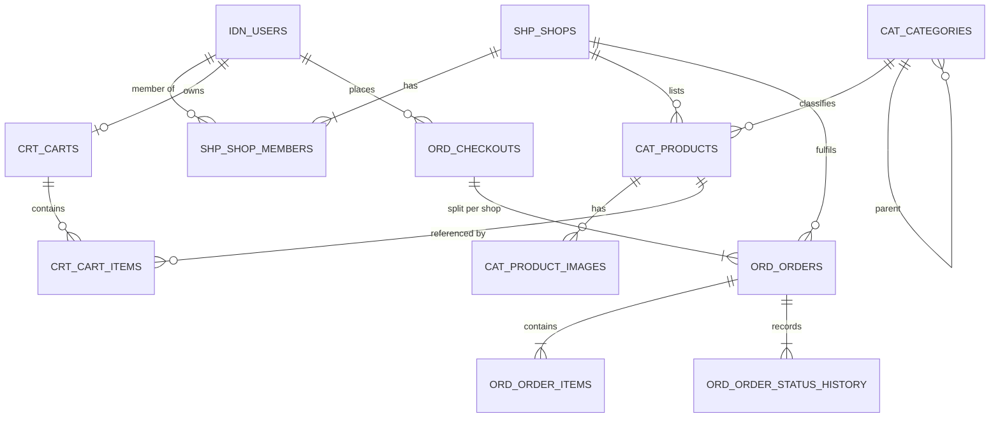

# Marketplace Core — Technical Reference (Stage 3)

Audience: developers working on the backend or frontend. Decisions and their rationale are in [ADR-0012](adr/0012-marketplace-core-domain.md). Status and verification results are in [PROJECT_STATUS.md](PROJECT_STATUS.md).

## 1. Business rules

### Shops
| Rule | Where enforced |
|---|---|
| Any signed-in user can apply to open a shop. The applicant becomes its **Owner**; the shop starts **PendingApproval** and is not public. | `Shop.Apply`, `ApplyForShopHandler` |
| Status transitions: PendingApproval → Active (admin approve); Active ⇄ Inactive (owner); any → Suspended (admin, reason required); Suspended → Active, or → PendingApproval if never approved (admin reinstate). | `Shop` methods; invalid moves → 422 |
| Only **Active** shops are listed publicly and accept orders. | Catalogue queries, cart, checkout |
| Shop-scoped rights come from membership: **Owner** has everything; **Staff** can manage catalogue and orders, but not the profile. Staff invitation endpoints are later work. | `ShopRolePermissions`, `ShopAccess` |
| A user who is not a member of a shop gets **403** on every `/my/shops/{shopId}/…` endpoint. | `ShopAccess` (application layer) |
| Every administrator decision (approve, suspend, reinstate, commission change) is written to the append-only audit log in the same transaction. | `AdminShopActionHandler`, `SetShopCommissionHandler` |

### Catalogue
| Rule | Where enforced |
|---|---|
| Every product belongs to exactly one shop and one category. | Domain + FKs |
| Price > 0, ≤ 1,000,000, at most the currency's minor units (2 decimals); always in the **marketplace currency**. | Validator, `Product`, `CK_CAT_PRODUCTS_PRICE` |
| Stock is 0…100,000 and can never go negative. | Validator, `Product`, `CK_CAT_PRODUCTS_STOCK` |
| A product is purchasable only if it is Active, has stock, and its shop is Active. | `Product.IsPurchasable`, queries |
| New products cannot use inactive categories; an existing product may keep one. | `Product.UpdateDetails`, handler |
| Images are **HTTPS URLs** (≤ 8, optional host allowlist), never file paths or binaries. | `ImageUrlPolicy`, `ProductImage` |
| Product and shop-profile updates require the `version` the client last read; a concurrent edit → **409**. | `ROW_VERSION` concurrency token |
| Search is case- and Turkish-accent-insensitive (`NORMALIZED_NAME`, e.g. "GULLER" finds "Güller"). A top-level category includes its sub-categories. | `SearchText`, `SearchProductsHandler` |

### Cart
| Rule | Where enforced |
|---|---|
| The cart stores only product ids and quantities (1–20 each, ≤ 50 lines). **Prices and totals are always recalculated on the server**; clients cannot send prices. | `Cart`, `CartPricer` |
| Adding an unavailable product or more than the stock → **409**. | `SetCartItemHandler` |
| Lines that became unavailable are flagged (`ProductUnavailable`, `ShopClosed`, `InsufficientStock`), excluded from totals, and block checkout. | `CartLineSnapshot.Issue` |
| **Products from several shops are allowed.** The cart is grouped by shop, and each group becomes one order. | `CartPricer`, `OrderPricing` |

### Checkout and orders
| Rule | Where enforced |
|---|---|
| `POST /checkout` requires an **Idempotency-Key** header (8–64 chars). (customer, key) is unique; repeating the request returns the original result (`replayed: true`). Concurrent duplicates resolve to the same checkout. | `UX_ORD_CHECKOUTS_CUSTOMER_ID_IDEMPOTENCY_KEY`, `PlaceCheckoutHandler` |
| Delivery date must be between today and today + 30 days **in the market time zone** (Europe/Istanbul). | `MarketCalendar` |
| One database transaction: atomic conditional stock reservation per line → checkout + one order per shop → cart cleared. The reservation UPDATE also requires the **quoted price to still match and the shop to be active** (otherwise `409 checkout.price_changed` / `items_unavailable`). Any failure rolls everything back, including stock reserved for earlier lines. | `PlaceCheckoutHandler`, `ProductStock` |
| Orders snapshot shop name, product names, unit prices, quantities, currency, delivery fee, commission rate, and amounts. Later catalogue changes never alter placed orders. | `Order.Place`, `OrderItem` |
| Status machine (below) is enforced by the domain; invalid transitions → **409** `order.invalid_transition`. | `OrderStatusTransitions` |
| Customers see only their own orders (others → **404**, so order numbers cannot be probed). Shops see only their own orders (another shop's order via their route → **404**). | Handlers |
| Customers may cancel until the shop accepts (PendingPayment, Paid). Shops reject (not cancel) paid orders. Administrators may cancel any non-terminal order. | `Order.Cancel` / `Reject` |
| Cancelled, Rejected, and Expired orders return their items to stock in the same transaction. If the order had been paid, `RefundDue` = total (refund execution is later work). | `OrderTransitionRunner` |
| Unpaid orders expire after `Marketplace:PaymentTimeout` (default 2 h); a background worker runs every 5 minutes. | `ExpireUnpaidOrdersHandler`, `OrderExpiryWorker` |
| **No payment provider.** An administrator can record a *manual* payment (e.g. bank transfer) with a reference. This is audited. | `RecordManualPaymentHandler` |

```
PendingPayment → Paid | Cancelled | Expired
Paid           → Accepted | Rejected | Cancelled
Accepted       → Preparing | Cancelled
Preparing      → ReadyForDelivery | Cancelled
ReadyForDelivery → Delivered | Cancelled
Delivered, Cancelled, Rejected, Expired: terminal
```
Actors: Customer (cancel before acceptance), Shop (accept, reject, prepare, ready, delivered), Administrator (record payment, cancel), System (expire). Every transition is appended to `ORD_ORDER_STATUS_HISTORY` with the actor, user id, and reason.

### Pricing, currency and commission
- Money is `decimal` in C# and `NUMBER(19,4)` in Oracle, with a `CHAR(3)` currency checked against the supported list. One marketplace currency (`Marketplace:Currency`); combining currencies throws.
- Per shop order: **Total = Subtotal + DeliveryFee − Discount**. The delivery fee is a flat fee per shop order (`Marketplace:DeliveryFeePerOrder`). Discount is 0 until promotions exist.
- **Commission** = round(base × rate, currency minor units, half away from zero), where base = item subtotal − discount (delivery fee excluded) and rate = shop override (basis points) or `Marketplace:DefaultCommissionRateBps`. **ShopEarnings = base − commission** exactly.
- Oracle CHECK constraints enforce `TOTAL = SUBTOTAL + DELIVERY_FEE − DISCOUNT` and `COMMISSION + SHOP_EARNINGS = COMMISSION_BASE` for every access path.
- Customers never see commission figures; shops and administrators do.

## 2. Entities, relationships and constraints

| Table (prefix = module) | Purpose | Key constraints and indexes |
|---|---|---|
| `SHP_SHOPS` | Shop profile and status | PK; UX slug; IX status; CK status ∈ enum; CK commission 0–10000 or NULL; `ROW_VERSION` |
| `SHP_SHOP_MEMBERS` | User ↔ shop with role | PK (shop, user); FK shop (cascade), FK user (restrict); IX user; CK role |
| `CAT_CATEGORIES` | Two-level categories (9 seeded) | PK; UX slug; FK parent (self, restrict) |
| `CAT_PRODUCTS` | Shop listings | PK; FK shop, category (restrict); IX (status, category), (shop, status); CK price > 0, stock ≥ 0, currency, status; `ROW_VERSION` |
| `CAT_PRODUCT_IMAGES` | Image URL metadata | PK; FK product (cascade); IX product |
| `CRT_CARTS` / `CRT_CART_ITEMS` | One cart per customer | UX customer; UX (cart, product); CK quantity 1–20; `ROW_VERSION` |
| `ORD_CHECKOUTS` | Customer-level purchase (idempotency, future payment) | UX (customer, idempotency key); CK currency |
| `ORD_ORDERS` | One shop's order with financial snapshot | UX order number; IX checkout, (customer, created), (shop, status, created), (status, created); FKs restrict; CK status, currency, commission rate, amounts, **total**, **commission split**; `ROW_VERSION` |
| `ORD_ORDER_ITEMS` | Line snapshots | FK order, product (restrict); CK quantity > 0, line total = price × qty |
| `ORD_ORDER_STATUS_HISTORY` | Lifecycle audit trail | **Append-only** for the runtime role (SELECT, INSERT) |
| `AUD_AUDIT_ENTRIES` | Sensitive-action audit log | **Append-only** for the runtime role; IX (entity type, id), occurred at |



**Oracle note:** Oracle stores `''` as NULL, so optional text (descriptions, postal codes, alt text, gift messages) is nullable and the domain stores `null` for blank values (`Guard.OptionalText`).

### Migrations
| Migration | Content |
|---|---|
| `InitialIdentity` | Identity tables, refresh sessions, `cicek_schema_access` v1 |
| `Marketplace` | 12 marketplace tables, constraints, indexes, 9 seeded categories, `cicek_schema_access` **v2** (append-only audit/history). `Down` restores v1. |
| `NullableOptionalText` | Makes 5 optional text columns nullable (fixes the empty-string issue above). `Down` only succeeds if no NULLs exist. |

## 3. API endpoints (`/api/v1`)

| Endpoint | Authorization |
|---|---|
| `GET /categories`, `GET /shops?q&page&pageSize`, `GET /shops/{slug}`, `GET /products?q&categoryId&shopId&minPrice&maxPrice&inStock&sort&page&pageSize`, `GET /products/{id}` | Anonymous (active data only) |
| `POST /shops` (apply) | Authenticated |
| `GET /my/shops`; `GET/PUT /my/shops/{shopId}`; `POST …/open`, `…/close` | Member (`PUT`/open/close: **Owner**) |
| `GET/POST /my/shops/{shopId}/products`; `GET/PUT …/products/{productId}`; `POST …/activate`, `…/deactivate` | Member with ManageCatalog (Owner, Staff) |
| `GET /my/shops/{shopId}/orders?status`; `GET …/orders/{orderNumber}`; `POST …/accept`, `…/reject` (reason), `…/start-preparation`, `…/mark-ready`, `…/mark-delivered` | Member with ManageOrders (Owner, Staff) |
| `GET /cart`; `PUT /cart/items/{productId}` (quantity); `DELETE /cart/items/{productId}`; `DELETE /cart` | Authenticated (own cart) |
| `POST /checkout` (`Idempotency-Key` header) | Authenticated |
| `GET /me/orders?status`; `GET /me/orders/{orderNumber}`; `POST /me/orders/{orderNumber}/cancel` | Authenticated (own orders; others → 404) |
| `GET /admin/shops?status`; `POST /admin/shops/{id}/approve`, `…/suspend` (reason), `…/reinstate`; `PUT /admin/shops/{id}/commission` | Permission `shops.manage` (Administrator) |
| `GET /admin/categories`; `POST /admin/categories`; `PUT /admin/categories/{id}` | `categories.manage` (Administrator) |
| `GET /admin/orders?status&shopId`; `GET /admin/orders/{orderNumber}` | `orders.read` (Administrator, Support, Finance) |
| `POST /admin/orders/{orderNumber}/record-payment` (reference); `POST /admin/orders/{orderNumber}/cancel` (reason) | `orders.manage` (Administrator) |

Error format: RFC 9457 Problem Details with a stable `code`. Validation → 400 (`errors` by field); domain rule → 422; conflict / invalid transition / concurrency → 409; not authenticated → 401; no permission or not a shop member → 403. Collections are paged (`page`, `pageSize` ≤ 50, `totalCount`, `totalPages`). Enums are serialized as strings. Numbers must be JSON numbers.

## 4. Configuration (`Marketplace` section)

| Key | Default | Meaning |
|---|---|---|
| `Currency` | `TRY` | Marketplace currency (must be supported) |
| `TimeZone` | `Europe/Istanbul` | Market time zone for delivery dates |
| `DefaultCommissionRateBps` | `1500` | 15 % unless a shop override exists |
| `DeliveryFeePerOrder` | `0` (appsettings: 49.90) | Flat fee per shop order |
| `MaxDeliveryDaysAhead` | `30` | Delivery date window |
| `PaymentTimeout` | `02:00:00` | Unpaid orders expire after this |
| `ImageHostAllowlist` | `[]` | Allowed image hosts; **empty allows any HTTPS host. Set it in production.** |

## 5. Frontend (storefront)

| Route | Content |
|---|---|
| `/products`, `/products/[id]` | Search, filter, sort, page (server-rendered; works without JS); detail with add-to-cart |
| `/shops`, `/shops/[slug]` | Florist list and a florist's products |
| `/cart`, `/checkout` | Server-priced cart grouped by shop; checkout form with one idempotency key per attempt |
| `/account/orders`, `/account/orders/[orderNumber]` | Order history (filter, paging), detail with timeline and cancellation |
| `/seller`, `/seller/shops/[shopId]/…` | Shop application, dashboard (open/close), product list/create/edit/(de)activate, order list/detail with allowed actions |

Each major screen has loading, empty, validation-error, and API-error states. No mock data: every screen reads the live API through the BFF (customer and seller) or from server components (public catalogue).

## 6. MVP additions (2026-10-19)

**Shop lifecycle** now includes `Rejected`: `PendingApproval → Rejected` (admin, reason required) `→ PendingApproval` (owner resubmit); approval cannot skip resubmission. Rejected shops are never public. The `SHP_SHOPS` CHECK constraint was changed by migration `ShopRejectedStatus`.

| Endpoint | Authorization |
|---|---|
| `POST /admin/shops/{id}/reject` (reason) | `shops.manage` |
| `GET /admin/shops?status&q&page` → shops with owner email and active product count; `GET /admin/shops/{id}` | `shops.manage` |
| `POST /my/shops/{shopId}/resubmit` | Shop **Owner**, only while `Rejected` |
| `GET /admin/overview` → shop/order counts per status, orders in the last 7 days, active products, users, order value, commission on delivered, refunds due (amounts only for orders in the marketplace currency) | `admin.overview.read` (Administrator, Support) |
| `GET /admin/users?q&role&page` → email, roles, lock state, created (no password hash, tokens or phone) | `users.read` (Administrator, Support) |

**Frontend routes added:** `/` (live featured florists and products), `/admin`, `/admin/shops`, `/admin/shops/[shopId]`, `/admin/orders`, `/admin/orders/[orderNumber]`, `/admin/categories`, `/admin/users`; seller dashboard gains rejection notice, resubmission and profile editing. Languages: `az` (default), `tr`, `en`.

**Dev-only data:** `DbMigrator seed-demo` (see README). Category seed names are Azerbaijani (migration `AzerbaijaniCategoryNames`).
